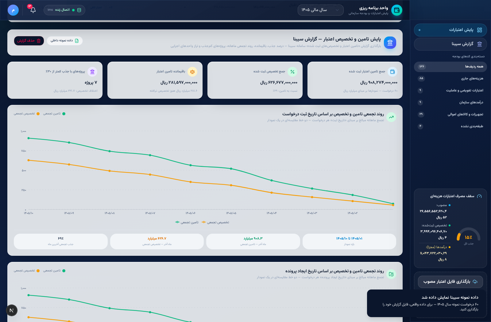

# داشبورد پایش اعتبارات و بودجه سازمانی — نسخه آفلاین

ابزار تک‌فایلی و کاملاً آفلاین پایش اعتبار مصوب، تامین اعتبار و تخصیص — بر پایه فایل اکسل «اعتبار مصوب» و «گزارش تامین و تخصیص‌های ثبت شده» (خروجی سامانه سیبنا). بدون نیاز به اینترنت، نصب، سرور یا پایگاه داده؛ کافی است فایل `dashboard.html` را باز کنید.


## دو نسخه

| فایل | مناسب برای |
|---|---|
| `dashboard.html` | کامپیوتر (دسکتاپ / لپ‌تاپ) — جداول کامل |
| `dashboard-mobile.html` | موبایل و تبلت — نمایش کارتی ردیف‌ها با دکمه‌های لمسی |

هر دو نسخه تمام امکانات را دارند و کاملاً آفلاین‌اند.

## ویژگی‌ها

- **کاملاً آفلاین** — کتابخانه SheetJS و فونت وزیرمتن داخل فایل تعبیه شده‌اند؛ هیچ درخواست شبکه‌ای انجام نمی‌شود.
- **بارگذاری تعاملی اکسل** — کشیدن و رها کردن یا انتخاب فایل (xlsx/xls)؛ سال مالی از نام فایل تشخیص داده می‌شود.
- **تشخیص خودکار ساختار فایل** — تعداد سرفصل‌ها، جای ستون‌ها، ردیف عنوان بالای هدر، ستون اضافه (مثل «ردیف»)، برگه‌های متعدد و حتی ارقام فارسیِ متنی به‌صورت خودکار شناسایی می‌شوند؛ در ساختارهای ناشناخته به‌جای نمایش صفر، خطای گویا اعلام می‌شود.
- **دسته‌بندی بر اساس پیشوند کد بودجه مصوب**:
  | پیشوند | دسته |
  |---|---|
  | 541 | هزینه‌های جاری |
  | 102 / 104 / 412 | اعتبارات تفویضی و عاملیت |
  | 413 / 414 / 416 / 423 | درآمدهای سازمان |
  | 616 | تجهیزات و کالاهای اموالی |
  | سایر | طبقه‌بندی نشده |
- **فیلتر ردیف‌های هر جدول** — نمایش ردیف‌های «نزدیک به سقف» (جذب ۸۵٪ و بیشتر)، جذب مطلوب، اعتبار کافی، نیازمند اصلاح بودجه، دارای تخصیص، بدون تخصیص و بدون تامین؛ جمع جدول با فیلتر همگام می‌شود.
- **خروجی هر جدول به سه شکل** — اکسل (xlsx)، PDF (از طریق پنجره چاپ با قالب آماده A4 افقی) و تصویر JPG (رندر مستقیم روی Canvas با فونت فارسی).
- **بخش مجزای «گزارش درآمدها»** — نمودار و جدول مستقل درآمدهای سازمان که همیشه نمایان است و هرگز با اعتبارات هزینه‌ای تجمیع نمی‌شود؛ حتی اگر فایل بارگذاری‌شده ردیف درآمدی نداشته باشد، پیام راهنما نمایش داده می‌شود.
- **انتقال / حذف کد بودجه** — هر ردیف قابل انتقال به دسته دیگر یا حذف نرم است؛ ردیف‌های حذف‌شده قابل بازگردانی (تکی یا گروهی) و کل تغییرات قابل بازنشانی هستند.
- **تفکیک کامل درآمدها** — درآمدهای سازمان در تمام شاخص‌ها، نمودارها و جداول به‌صورت مجزا نمایش داده می‌شوند و هرگز با اعتبارات هزینه‌ای تجمیع نمی‌گردند (تنها استثنا: نمودار مقایسه سه‌گانه جمع مصوب/تامین/تخصیص در ابتدای صفحه).
- **گیج‌های نیم‌دایره سرعت‌سنجی** — درصد جذب هر دسته با عقربه و ناحیه‌بندی رنگی.
- **دونات‌های سه‌بعدی** — دونات کلی سهم دسته‌ها + دونات مستقل هر دسته با حجم سه‌بعدی (SVG خالص)؛ رنگ «بدون تامین» و «طبقه‌بندی نشده» کرم است.
- **جداول تفصیلی دسته‌بندی‌شده** — سرتیتر **سبز تیره**، جستجوی داخل هر جدول، کد بودجه با فونت درشت‌متن، تمام مبالغ به **ریال**، نمایش تفکیک سرفصل‌ها با کلیک روی هر ردیف.
- **حفظ داده‌ها** — فایل بارگذاری‌شده و تغییرات دسته‌بندی در `localStorage` همان دستگاه ذخیره می‌شود؛ با دکمه «حذف فایل بارگذاری‌شده» به داده پیش‌فرض ۱۴۰۵ بازمی‌گردید.
- **خروجی گزارش تلفیقی اکسل** — دو برگه مجزا: «اعتبارات هزینه‌ای» و «درآمدهای سازمان».
- **داده پیش‌فرض** — نمونه واقعی «اعتبار مصوب ۱۴۰۵» (۱۳۶ ردیف) داخل فایل تعبیه شده است.

## بخش «گزارش سیبنا» — پایش تامین و تخصیص

بخش اختصاصی بارگذاری فایل اکسل «گزارش کامل تامین اعتبار و تخصیص‌های ثبت شده» سامانه سیبنا:

- **جدول همه درخواست‌های ثبت شده** — برای هر درخواست: شماره درخواست، تاریخ ثبت، شماره پرونده، تاریخ ایجاد پرونده، واحد اجرایی، پروژه/شرح، مبلغ تامین و تخصیص (ریال)، **درصد جذب** (نسبت تخصیص به تامین) و **باقیمانده تامین اعتبار** + جستجو، فیلتر وضعیت جذب، صفحه‌بندی و خروجی اکسل.
- **روند تجمعی تامین و تخصیص بر اساس تاریخ ثبت درخواست** — دو خط مقایسه‌ای در یک نمودار، تجمع ماهانه.
- **روند تجمعی بر اساس تاریخ ایجاد پرونده** — دو خط مقایسه‌ای در یک نمودار (مبنای دوم زمانی).
- **پنل پروژه‌های با بیشترین اختلاف تامین و تخصیص** — پروژه‌هایی که نسبت جذب آنها کمتر از ۳۰٪ است، مرتب بر اساس باقیمانده.
- **تراز تامین و تخصیص در واحدهای اجرایی** — نمودار میله‌ای انباشته بر مبنای سهم تخصیص‌یافته و باقیمانده هر واحد (ریال).
- **نمایش با داده نمونه** و **دانلود قالب نمونه اکسل** برای شروع سریع.
- تشخیص خودکار نوع فایل: اگر در قسمت بارگذاری اصلی، فایل گزارش سیبنا (دارای ستون تاریخ + تامین/تخصیص) قرار دهید، مستقیماً به بخش سیبنا می‌رود؛ فایل «اعتبار مصوب» به داشبورد اعتبارات.
- تاریخ‌ها به هر شکلی (شمسی متنی، ارقام فارسی، سریال اکسل، میلادی) پذیرفته و به جلالی تبدیل می‌شوند.



## نحوه استفاده

1. فایل `dashboard.html` (کامپیوتر) یا `dashboard-mobile.html` (موبایل) را دانلود کنید.
2. روی هر دستگاهی (ویندوز، مک، لینوکس، اندروید، iOS) با مرورگر آن را باز کنید — دابل‌کلیک کافی است؛ نیازی به اینترنت نیست.
3. برای شروع، داده نمونه ۱۴۰۵ نمایش داده می‌شود؛ فایل اکسل «اعتبار مصوب» سال خود را با دکمه **بارگذاری فایل اعتبار مصوب** بارگذاری کنید.
4. داده‌ها روی همان دستگاه باقی می‌مانند؛ برای پاک‌سازی، دکمه **حذف فایل بارگذاری‌شده** را بزنید.

> نکته: اگر فایل اکسل از فرمول استفاده می‌کند و مقادیر ذخیره‌شده ندارد، ابتدا آن را در اکسل باز و با Save ذخیره کنید تا مقادیر محاسبه‌شده ثبت شود.


## ساختار مورد انتظار فایل اکسل

### ۱) اعتبار مصوب

سرستون‌های زیر (با هر ترتیبی) به‌صورت خودکار شناسایی می‌شوند:

- `کد بودجه مصوب` — مبنای دسته‌بندی (پیشوند)
- `شرح اعتبار مصوب` — برچسب نمایش ردیف‌ها
- `عنوان دستگاه بهره بردار` و `عنوان دستگاه اجرایی` — اطلاعات تکمیلی
- سه‌تایی‌های `اعتبار مصوب / تامین اعتبار / تخصیص` به ازای هر سرفصل + سه‌تایی «جمع» در انتها
- ستون `درصد جذب` (اختیاری — در نبود آن از نسبت مبالغ محاسبه می‌شود)
- ستون `عنوان سطح 4 (خدمت)` نادیده گرفته می‌شود.

### ۲) گزارش تامین و تخصیص سیبنا

سرستون‌های زیر (با هر ترتیب و نام مشابه) شناسایی می‌شوند:

- `شماره درخواست` / `شماره سند`
- `تاریخ ثبت درخواست` / `تاریخ صدور`
- `شماره پرونده` و `تاریخ ایجاد پرونده`
- `کد بودجه`، `شرح`، `واحد اجرایی`، `عنوان پروژه`
- `مبلغ تامین اعتبار (ریال)` و `مبلغ تخصیص ثبت شده (ریال)`

قالب نمونه از دکمه «دانلود قالب نمونه» در بخش سیبنا قابل دریافت است.

## اجرا از طریق سرور محلی (اختیاری)

برای برخی مرورگرهای قدیمی که `localStorage` را روی `file://` محدود می‌کنند:

```bash
python -m http.server 8000
# سپس http://localhost:8000/dashboard.html
```

## ساختار مخزن

```
├── dashboard.html            ← ابزار اصلی (تک‌فایل، آفلاین — کامپیوتر)
├── dashboard-mobile.html     ← نسخه موبایل (تک‌فایل، آفلاین — نمایش کارتی)
├── index.html                ← ریدایرکت به dashboard.html (برای GitHub Pages)
├── docs/
│   ├── screenshot-desktop.png
│   ├── screenshot-mobile.png
│   └── screenshot-sibna.png
├── LICENSE
└── README.md
```

## فناوری

HTML + CSS + JavaScript خالص (بدون فریم‌ورک)، SheetJS (تعبیه‌شده)، فونت وزیرمتن (تعبیه‌شده)، دونات سه‌بعدی و نمودارهای SVG دست‌ساز، رندر JPG با Canvas. حجم هر فایل حدود ۱٫۱ مگابایت.
