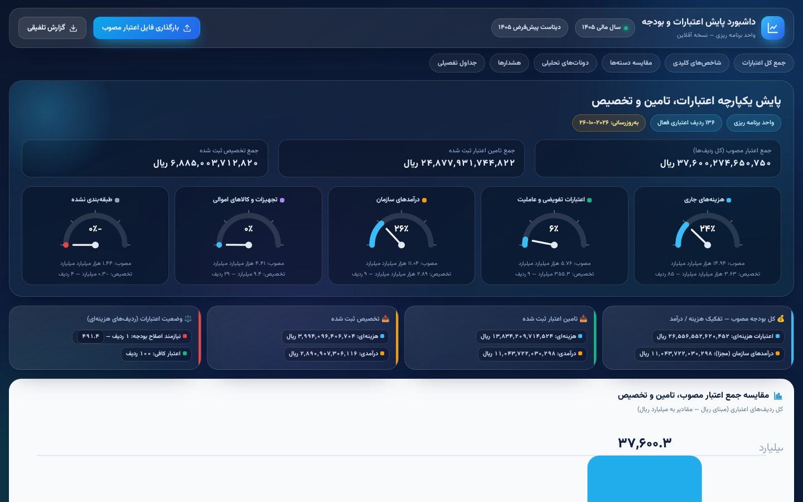
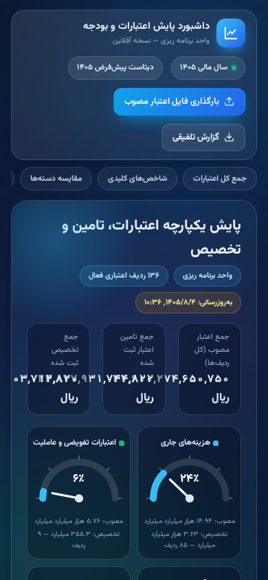

# داشبورد پایش اعتبارات و بودجه سازمانی — نسخه آفلاین

ابزار تک‌فایلی و کاملاً آفلاین پایش اعتبار مصوب، تامین اعتبار و تخصیص — بر پایه فایل اکسل «اعتبار مصوب» (خروجی سیبنا). بدون نیاز به اینترنت، نصب، سرور یا پایگاه داده؛ کافی است فایل `dashboard.html` را باز کنید.



## ویژگی‌ها

- **کاملاً آفلاین** — کتابخانه SheetJS و فونت وزیرمتن داخل فایل تعبیه شده‌اند؛ هیچ درخواست شبکه‌ای انجام نمی‌شود.
- **موبایل و دسکتاپ** — رابط راست‌به‌چپ فارسی با چیدمان واکنش‌گرا (گوشی، تبلت، دسکتاپ).
- **بارگذاری تعاملی اکسل** — کشیدن و رها کردن یا انتخاب فایل (xlsx/xls)؛ سال مالی از نام فایل تشخیص داده می‌شود.
- **تشخیص خودکار ساختار فایل** — تعداد سرفصل‌ها، جای ستون‌ها، ردیف عنوان بالای هدر، ستون اضافه (مثل «ردیف»)، برگه‌های متعدد و حتی ارقام فارسیِ متنی به‌صورت خودکار شناسایی می‌شوند؛ در ساختارهای ناشناخته به‌جای نمایش صفر، خطای گویا اعلام می‌شود.
- **دسته‌بندی بر اساس پیشوند کد بودجه مصوب**:
  | پیشوند | دسته |
  |---|---|
  | 541 | هزینه‌های جاری |
  | 102 / 104 / 412 | اعتبارات تفویضی و عاملیت |
  | 413 / 414 / 416 / 423 | درآمدهای سازمان |
  | 616 | تجهیزات و کالاهای اموالی |
  | سایر | طبقه‌بندی نشده |
- **انتقال / حذف کد بودجه** — هر ردیف قابل انتقال به دسته دیگر یا حذف نرم است؛ ردیف‌های حذف‌شده قابل بازگردانی (تکی یا گروهی) و کل تغییرات قابل بازنشانی هستند.
- **تفکیک کامل درآمدها** — درآمدهای سازمان در تمام شاخص‌ها، نمودارها و جداول به‌صورت مجزا نمایش داده می‌شوند و هرگز با اعتبارات هزینه‌ای تجمیع نمی‌گردند (تنها استثنا: نمودار مقایسه سه‌گانه جمع مصوب/تامین/تخصیص در ابتدای صفحه).
- **گیج‌های نیم‌دایره سرعت‌سنجی** — درصد جذب هر دسته با عقربه و ناحیه‌بندی رنگی.
- **نمودارها بدون کتابخانه خارجی** — SVG خالص: مقایسه سه‌گانه جمع کل، میله‌ای گروهی به تفکیک دسته (پنل مجزای درآمدها با مقیاس مستقل)، دونات کلی + دونات مستقل هر دسته.
- **جداول تفصیلی دسته‌بندی‌شده** — جستجوی داخل هر جدول، سرستون روشن با متن تیره، کد بودجه با فونت درشت‌متن، تمام مبالغ به **ریال**، نمایش تفکیک سرفصل‌ها با کلیک روی هر ردیف.
- **حفظ داده‌ها** — فایل بارگذاری‌شده و تغییرات دسته‌بندی در `localStorage` همان دستگاه ذخیره می‌شود؛ با دکمه «حذف فایل بارگذاری‌شده» به داده پیش‌فرض ۱۴۰۵ بازمی‌گردید.
- **خروجی گزارش تلفیقی اکسل** — دو برگه مجزا: «اعتبارات هزینه‌ای» و «درآمدهای سازمان».
- **داده پیش‌فرض** — نمونه واقعی «اعتبار مصوب ۱۴۰۵» (۱۳۶ ردیف) داخل فایل تعبیه شده است.

## نحوه استفاده

1. فایل `dashboard.html` را دانلود کنید.
2. روی هر دستگاهی (ویندوز، مک، لینوکس، اندروید، iOS) با مرورگر آن را باز کنید — دابل‌کلیک کافی است.
3. برای شروع، داده نمونه ۱۴۰۵ نمایش داده می‌شود؛ فایل اکسل «اعتبار مصوب» سال خود را با دکمه **بارگذاری فایل اعتبار مصوب** (یا کشیدن و رها کردن در کادر پایین صفحه) بارگذاری کنید.
4. داده‌ها روی همان دستگاه باقی می‌مانند؛ برای پاک‌سازی، دکمه **حذف فایل بارگذاری‌شده** را بزنید.

> نکته: اگر فایل اکسل از فرمول استفاده می‌کند و مقادیر ذخیره‌شده ندارد، ابتدا آن را در اکسل باز و با Save ذخیره کنید تا مقادیر محاسبه‌شده ثبت شود.



## ساختار مورد انتظار فایل اکسل

سرستون‌های زیر (با هر ترتیبی) به‌صورت خودکار شناسایی می‌شوند:

- `کد بودجه مصوب` — مبنای دسته‌بندی (پیشوند)
- `شرح اعتبار مصوب` — برچسب نمایش ردیف‌ها
- `عنوان دستگاه بهره بردار` و `عنوان دستگاه اجرایی` — اطلاعات تکمیلی
- سه‌تایی‌های `اعتبار مصوب / تامین اعتبار / تخصیص` به ازای هر سرفصل + سه‌تایی «جمع» در انتها
- ستون `درصد جذب` (اختیاری — در نبود آن از نسبت مبالغ محاسبه می‌شود)
- ستون `عنوان سطح 4 (خدمت)` نادیده گرفته می‌شود.

## اجرا از طریق سرور محلی (اختیاری)

برای برخی مرورگرهای قدیمی که `localStorage` را روی `file://` محدود می‌کنند:

```bash
python -m http.server 8000
# سپس http://localhost:8000/dashboard.html
```

## ساختار مخزن

```
├── dashboard.html            ← خود ابزار (تک‌فایل، آفلاین)
├── docs/
│   ├── screenshot-desktop.png
│   └── screenshot-mobile.png
├── LICENSE
└── README.md
```

## فناوری

HTML + CSS + JavaScript خالص (بدون فریم‌ورک)، SheetJS (تعبیه‌شده)، فونت وزیرمتن (تعبیه‌شده)، نمودارهای SVG دست‌ساز. حجم فایل نهایی حدود ۱٫۱ مگابایت.
